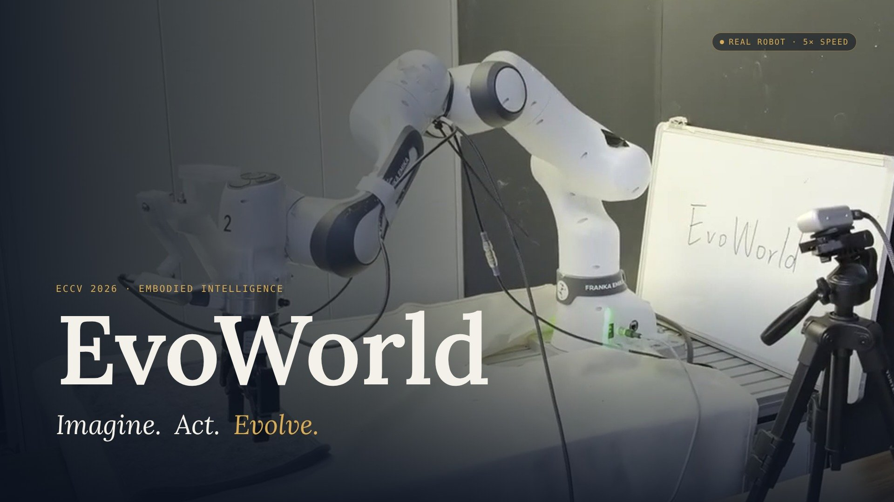
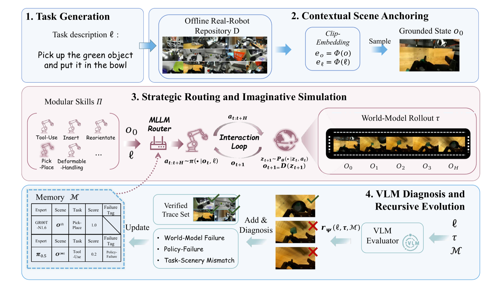

<div align="center">

<h1>EvoWorld</h1>
<h3>A World-Model-Centric Framework for Continuous Self-Evolution of Modular Embodied Skills</h3>

<p><strong><a href="https://doczbs.github.io/">Boshi Zhang</a><sup>1,*</sup> · Sen Cui<sup>1,*,‡</sup> · BaoHuaYin<sup>3</sup> · Youyi Kou<sup>4</sup> · Junyu Wu<sup>5</sup> · Zuo Pu<sup>1</sup> · Tao Xue<sup>1</sup> · Zhikang Chen<sup>2</sup> · Shanshan Wei<sup>1</sup> · Min Zhang<sup>6</sup> · Miao Liu<sup>1</sup> · Changshui Zhang<sup>1,†</sup> · Zhang Tao<sup>1,†</sup></strong></p>

<p><sup>1</sup> Tsinghua University · <sup>2</sup> University of Oxford · <sup>3</sup> University of Sussex<br>
<sup>4</sup> Beijing Jiaotong University · <sup>5</sup> Xiamen University · <sup>6</sup> East China Normal University</p>

<p><sup>*</sup> Equal contribution · <sup>‡</sup> Project leader · <sup>†</sup> Corresponding authors</p>

<p>
  <a href="https://doczbs.github.io/EvoWorld/"></a>
  <a href="https://eccv.ecva.net/virtual/2026/poster/5417"></a>
  <a href="https://doczbs.github.io/EvoWorld/#film"></a>
  <a href="LICENSE"></a>
  <a href="https://doczbs.github.io/EvoWorld/#demos"></a>
</p>

<p><em>Imagine. Act. Evolve.</em><br>A shared world model. An expandable library of skills. A loop that learns from failure.</p>

</div>

<p align="center">
  <a href="https://doczbs.github.io/EvoWorld/#film"></a>
  <br><sub><a href="https://doczbs.github.io/EvoWorld/#film">▶ Watch the research film</a> · 1:06 · World-model rollouts and real-robot demonstrations</sub>
</p>

## 📣 News

- **2026.06** — EvoWorld accepted at **ECCV 2026** as a Poster.

## 🔎 Overview

**EvoWorld (EvoW)** organizes Vision-Language-Action (VLA) models into a library of pluggable experts. A router selects candidate skills for a task and scene; a shared, action-conditioned world model imagines their outcomes before execution. A vision-language evaluator diagnoses the resulting trajectory and directs targeted updates to grounding and router memory, the selected expert, or the world model.

The framework follows four stages:

1. **Task generation** — propose tasks for skill development.
2. **Contextual scene anchoring** — ground each task in a recorded real scene.
3. **Strategic routing and imaginative simulation** — compare experts through predicted rollouts.
4. **VLM diagnosis and recursive evolution** — identify failures and update the relevant component.

<p align="center">
  <a href="site/static/images/method.png"></a>
</p>

## 📌 Highlights

- **Shared dynamics, specialized skills.** Combine GR00T-N1.6, π₀.₅, π₀, and π₀-FAST through a common orchestration layer.
- **Imagine before acting.** Use Ctrl-World rollouts to compare candidate actions before physical execution.
- **Targeted improvement.** Use Qwen3-VL diagnosis to select component-specific updates rather than retraining the whole system.

See the [project results](https://doczbs.github.io/EvoWorld/#results) and [ECCV paper page](https://eccv.ecva.net/virtual/2026/poster/5417) for experimental results.

## ⚙️ Installation

The core package requires **Python 3.11+** and [uv](https://docs.astral.sh/uv/). Backend training runs in separate Linux/CUDA environments.

```bash
git clone --recursive https://github.com/DocZbs/EvoWorld.git
cd EvoWorld
git submodule update --init --recursive
uv sync --python 3.11 --extra dev
uv run python scripts/verify_submodules.py
```

## 🚀 Quick start

Run one round with deterministic adapters to check the orchestration locally. This mode requires no robot or model checkpoints; it does not reproduce the paper's experiments.

```bash
uv run evoworld validate --config configs/dry_run.toml
uv run evoworld run --config configs/dry_run.toml --rounds 1
```

Run artifacts are saved under `artifacts/runs/`. To resume an existing run, replace `<run-id>` with its directory name:

```bash
uv run evoworld resume --run-dir artifacts/runs/<run-id>
```

For model-backed execution, follow the [real runtime setup](docs/backends/real_composition.md).

## 🛠️ Fine-tuning

Fine-tuning is **plan-first**: review the job specification before launching training. Copy the example configuration and replace its placeholder paths with your dataset, checkpoint, and output locations.

```bash
cp configs/finetune/pi05.example.toml /absolute/path/pi05.toml
# Edit the copied configuration before planning.
uv run evoworld finetune plan --config /absolute/path/pi05.toml --target pi05
```

Then execute the `job.json` path returned by the planner:

```bash
uv run evoworld finetune execute --job /absolute/path/to/job.json
```

Supported targets: `pi05`, `pi0`, `pi0_fast`, `groot_n16`, `ctrl_world`, and `qwen_evaluator`. See the [fine-tuning guide](docs/fine_tuning.md) for data formats, GPU requirements, and backend recipes.

## 🗂️ Repository layout

```text
src/evoworld/   Orchestration, routing, adapters, diagnosis, and durable execution
configs/       Dry-run, expert, world-model, evaluator, and training configurations
integrations/  Bridges to the upstream policy and world-model implementations
training/      Training support code
third_party/   Pinned OpenPI, Isaac GR00T, and Ctrl-World submodules
docs/          Architecture, data contracts, backend setup, and fine-tuning guides
scripts/       Submodule verification and release checks
tests/         Core and backend tests
site/          Project page, figures, videos, and paper
```

## 📖 Documentation

| Guide | Contents |
| --- | --- |
| [Architecture](docs/architecture.md) | Pipeline stages, component boundaries, and resumable execution |
| [Data contracts](docs/data.md) | Required manifests and artifact formats |
| [Real runtime](docs/backends/real_composition.md) | Compose model backends with your robot infrastructure |
| [OpenPI](docs/backends/openpi.md) · [GR00T](docs/backends/groot.md) | Expert policy integration |
| [Ctrl-World](docs/backends/ctrl_world.md) · [Qwen3-VL](docs/backends/qwen_vl.md) | Imaginative simulation and trajectory evaluation |
| [Fine-tuning](docs/fine_tuning.md) | Plan and execute component-specific training |

## 🧪 Data and models

The public repository provides deterministic orchestration, pinned upstream submodules, backend bridges, and data contracts. Private trajectories, annotations, trained weights, projector calibration, and robot control code are not included.

Real training and closed-loop execution require operator-provided data, checkpoints, calibration, robot infrastructure, and safety controls. The public Qwen3-VL training configuration is a configurable baseline, not the exact private recipe used for the reported experiments.

## 📄 License

EvoWorld’s original code is released under the [MIT License](LICENSE). Third-party submodules, datasets, and model weights remain subject to their respective licenses.

## 📚 Citation

```bibtex
@inproceedings{zhang2026evoworld,
  title={EvoWorld: A World-Model-Centric Framework for Continuous Self-Evolution of Modular Embodied Skills},
  author={Boshi Zhang and Sen Cui and {BaoHuaYin} and Youyi Kou and Junyu Wu and Zuo Pu and Tao Xue and Zhikang Chen and Shanshan Wei and Min Zhang and Miao Liu and Changshui Zhang and {Zhang Tao}},
  booktitle={European Conference on Computer Vision},
  year={2026}
}
```
